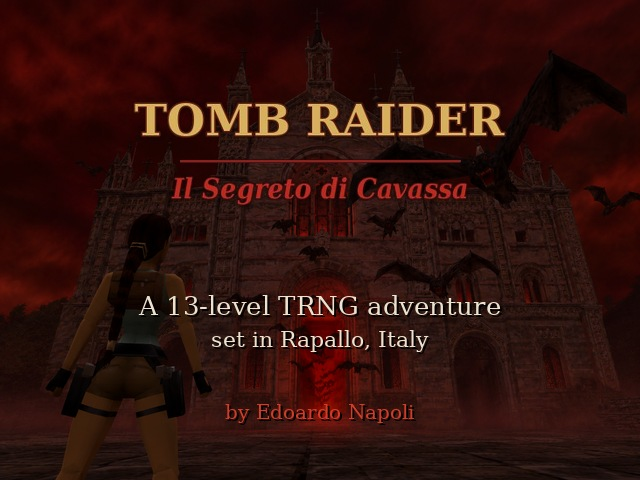
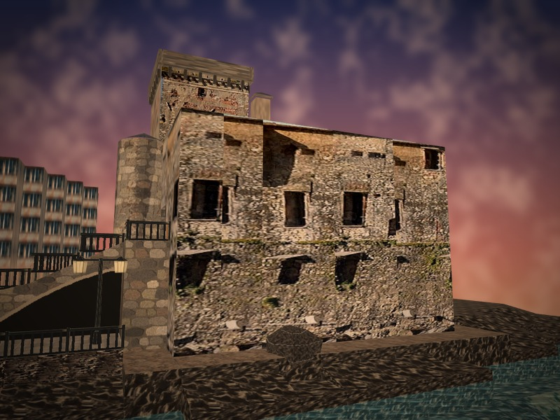
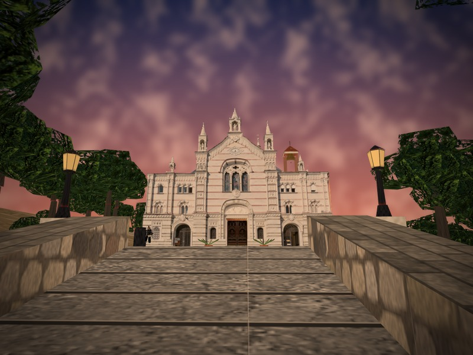
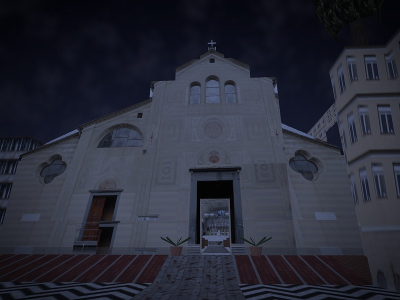
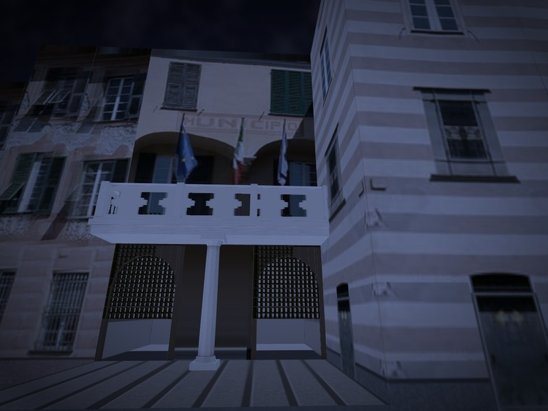

# Il Segreto di Cavassa

A free, fan-made Tomb Raider adventure in 13 levels, set in Rapallo, on the Italian Riviera.
Built on the Tomb Raider: The Last Revelation engine with TRNG.

**[Download the latest release](../../releases/latest)**

[Versione italiana più sotto](#italiano)

---

## The story

Rapallo. People in town have been disappearing for weeks. Lara Croft arrives at sunset, following a name she found in an old diary: Cavassa. The diary speaks of a red door, up on the mountain.

Some doors should always stay closed.

## Real places

Every location in the game exists. The maps are built from OpenStreetMap data and from photos taken on site: the castle by the sea, the Montallegro sanctuary and its cable car, San Francesco, the town hall, the old lazzaretto, Valle Christi and more.

## The levels

| # | Level | |
|---|---|---|
| 1 | Il Castello sul Mare | The Castle by the Sea |
| 2 | Il Santuario di Montallegro | The Montallegro Sanctuary |
| 3 | La Chiesa Profanata | The Desecrated Church |
| 4 | Infiltrazione Notturna | Night Infiltration |
| 5 | Il Rito in Nero | The Black Rite |
| 6 | La Torre nella Pioggia | The Tower in the Rain |
| 7 | La Messa Nera | The Black Mass |
| 8 | L'Avvertimento Apocalittico | The Apocalyptic Warning |
| 9 | Le Fondamenta | The Foundations |
| 10 | La Lama di Luce | The Blade of Light |
| 11 | Evacuazione | Evacuation |
| 12 | La Porta Rossa | The Red Door |
| 13 | La Cattedrale di Carne | The Cathedral of Flesh |

## Screenshots

| | |
|---|---|
|  |  |
|  |  |

## How to play

1. Download the zip from [Releases](../../releases/latest).
2. Extract it anywhere, keeping the folder structure.
3. Run the launcher. No installation and no original Tomb Raider needed.

Requirements: Windows. The intro and ending movies are .wmv files: if they don't play, make sure Windows Media Player is installed (Windows N editions need the Media Feature Pack).

Some antivirus programs flag `tomb4.exe`. This is a known false positive with Tomb Raider custom levels: the executable is old, unsigned and patched by TRNG.

In-game text and movie captions are in Italian. The end credits are in English.

## Credits

| | |
|---|---|
| Concept, story, storyboard and direction | Edoardo Napoli |
| Audio, music and sound design | Edoardo Napoli |
| Level design, tweaking and testing | Edoardo Napoli |
| AI-assisted development | Claude (Anthropic) |
| Ending FMV narration | generated with Suno |
| Beta testing | Attila, Low |
| Tools | Tomb Editor, WadTool, TombIDE, NG Center (TRNG) |
| Map data | © OpenStreetMap contributors, ODbL |

### A note on AI

This game was made together with Claude, Anthropic's AI assistant. Claude wrote the generators that build the maps from OpenStreetMap data, created models, textures and objects, wrote the script, edited the movies and patched the executable for the end credits. Edoardo came up with the story, directed the work, supplied the photos and reference images, made the audio and music, tweaked the levels in Tomb Editor and tested them, together with the beta testers.

## Legal

Free, fan-made, non-commercial project. Tomb Raider and Lara Croft are trademarks of their respective owners; this project is not affiliated with or endorsed by them. You are free to download, play and share the game as it is. Please don't sell it or redistribute modified versions without asking. See [LICENSE.md](LICENSE.md).

---

## Italiano

Un'avventura di Tomb Raider gratuita e amatoriale in 13 livelli, ambientata a Rapallo. Gira sul motore di Tomb Raider: The Last Revelation con TRNG.

**[Scarica l'ultima versione](../../releases/latest)**

Da settimane, a Rapallo, la gente sparisce. Lara Croft arriva al tramonto sulle tracce di un nome trovato in un vecchio diario: Cavassa. Il diario parla di una porta rossa, sulla montagna.

I luoghi del gioco esistono davvero: le mappe sono costruite sui dati di OpenStreetMap e sulle foto scattate sul posto.

**Come giocare:** scarica lo zip da [Releases](../../releases/latest), estrailo dove vuoi mantenendo le cartelle e avvia il launcher. Non serve installare niente e non serve il Tomb Raider originale. Se l'antivirus segnala `tomb4.exe`, è un falso positivo noto dei livelli custom.

**Sull'IA:** il gioco è stato fatto insieme a Claude, l'assistente IA di Anthropic. Claude ha scritto i generatori delle mappe, ha creato modelli, texture e oggetti, ha scritto lo script, ha montato i filmati e ha modificato l'eseguibile per i titoli di coda. Storia, regia, foto, audio, musiche, rifinitura dei livelli e test sono di Edoardo, con i beta tester Attila e Low. La voce narrante del filmato finale è generata con Suno.
